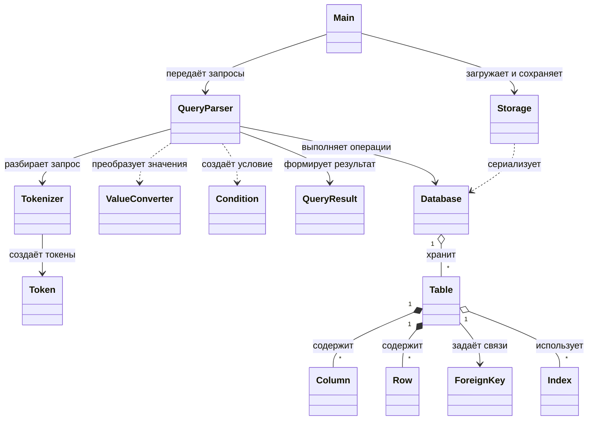
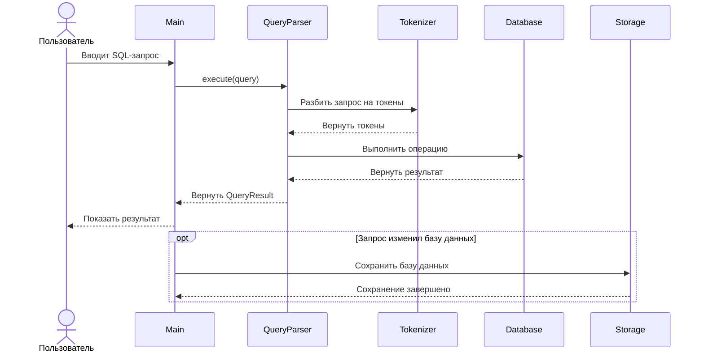

# JavaDB

Упрощённая система управления базами данных на Java. Программа хранит связанные таблицы, выполняет SQL-подобные запросы через консоль, сохраняет состояние на диск и поддерживает индексы.

## Возможности

- Создание и удаление таблиц: `CREATE TABLE`, `DROP TABLE`.
- Типы столбцов: `INTEGER`, `REAL`, `STRING`, `DATE`, `BOOLEAN`.
- Первичные и внешние ключи.
- Вставка одной или нескольких записей.
- Выборка всех столбцов или выбранных столбцов с условием `WHERE`.
- Обновление и удаление записей по условию.
- Создание индекса командой `CREATE INDEX` и поиск по индексированному столбцу.
- Сериализация базы в файл и восстановление при запуске.
- Табличный вывод результатов в консоли.

## Архитектура

`Main` запускает консоль, загружает базу и передаёт запросы в `QueryParser`. Парсер использует `Tokenizer` для разбиения запроса на токены, а `ValueConverter` — для преобразования значений к типам столбцов. `Database` управляет таблицами, а `Storage` сохраняет и загружает всю базу.

### Диаграмма классов



### Диаграмма последовательности запроса



## Хранение данных

База сериализуется в файл `data/database.ser`. Путь `data` задаётся относительно текущей рабочей папки, из которой запущена программа.

При первом запуске, если база пуста, программа создаёт демонстрационные таблицы `groups` и `students`. Столбец `students.group_id` связан с `groups.id`. При последующих запусках программа загружает сохранённую базу, включая таблицы, записи и индексы.

После успешных операций, меняющих базу, программа сохраняет её на диск.

## Сборка и запуск

Требуется JDK 8 или новее. Команды выполняются из корневой папки проекта:

```bash
javac -d out src/database/*.java
java -cp out database.Main
```

В консоли введи `HELP`, чтобы увидеть список команд. Каждый SQL-запрос заверши точкой с запятой `;`. Для выхода введи `EXIT`.

## Примеры команд

При первом запуске уже созданы таблицы `groups` и `students`.

### Просмотр таблиц и структуры

```sql
SHOW TABLES;
DESCRIBE students;
```

### Выборка

```sql
SELECT * FROM students;
SELECT name, age FROM students WHERE age > 18;
```

### Вставка одной записи

```sql
INSERT INTO students VALUES (4, 'Галя', 21, 2);
```

### Вставка нескольких записей

```sql
INSERT INTO students VALUES
    (5, 'Дима', 22, 1),
    (6, 'Елена', 19, 2);
```

### Вставка с указанием столбцов

```sql
INSERT INTO students (id, name, age, group_id)
VALUES (7, 'Ирина', 20, 1);
```

Если при вставке не указаны некоторые столбцы, они получают значение `NULL`.

### Обновление и удаление

```sql
UPDATE students SET age = 22 WHERE id = 4;
DELETE FROM students WHERE name = 'Галя';
```

### Создание индекса

```sql
CREATE INDEX idx_students_age ON students (age);
SELECT name, age FROM students WHERE age >= 20;
```

В результате запроса программа показывает, был ли использован индекс или выполнен полный перебор таблицы.

### Создание таблицы со всеми типами и связью

```sql
CREATE TABLE cars (
    id INTEGER PRIMARY KEY,
    brand STRING,
    price REAL,
    available BOOLEAN,
    release_date DATE,
    group_id INTEGER REFERENCES groups(id)
);
```

Пример вставки и выборки:

```sql
INSERT INTO cars VALUES
    (1, 'Toyota', 25000.0, TRUE, '2024-02-03', 1);

SELECT brand, price FROM cars WHERE price > 20000.0;
```

Даты указываются в формате `YYYY-MM-DD`, строки и даты заключаются в одинарные кавычки, логические значения задаются как `TRUE` или `FALSE`.

### Удаление таблицы

```sql
DROP TABLE cars;
```

## Проверка работы

Проверка выполнялась вручную в консоли на временной копии базы:

- проект компилируется командой `javac`;
- проверены вставка одной и нескольких записей, в том числе с перечислением столбцов;
- проверены выборка, обновление и удаление по условию;
- проверены типы `INTEGER`, `REAL`, `STRING`, `DATE`, `BOOLEAN`;
- повторный первичный ключ отклоняется;
- вставка записи с отсутствующим связанным ключом отклоняется;
- проверены `CREATE TABLE`, `DROP TABLE` и `CREATE INDEX`;
- после перезапуска сохранённые таблицы, записи и индекс загружаются;
- проверено, что индекс остаётся актуальным после вставки, обновления и удаления записей.

## Производительность индекса

Для ориентировочного сравнения была создана таблица из 5000 записей и выполнен поиск одной записи по столбцу `lookup`.

| Вариант поиска | Время выполнения |
|---|---:|
| Полный перебор таблицы без индекса | 1,149 мс |
| Поиск с индексом, первый замер | 0,207 мс |
| Поиск с индексом, повторные замеры | 0,091–0,128 мс |

В этом прогоне поиск с индексом был примерно в 5,5–12,6 раза быстрее. Это результат одного ручного запуска; он зависит от компьютера, состояния JVM и размера данных. Замер является ориентировочным, а не полноценным бенчмарком.

## Ограничения

Реализовано упрощённое подмножество SQL для учебной задачи. Условие `WHERE` задаётся одним сравнением столбца со значением. Полная совместимость с SQL и все возможности промышленных СУБД не предполагаются.

## Участники и вклад

Распределение указано по истории коммитов и объединённым веткам проекта.

| Участник | Вклад |
|---|---|
| Афина Хаширова 25КНТ-5 / `mfrtem` | Модель базы данных и таблиц, поддержка типа `DATE`, сериализация, документация Javadoc, интеграция изменений и ручная проверка |
| Иван Гапон 25КНТ-6 / `IvanGapon` | Хранение и индексы, включая оптимизацию поиска по индексированным столбцам |
| Мария Артемьева 25КНТ-5 / `MilkiWay123` | SQL-подобный парсер и консоль, токенизация запросов и связанные классы |

## Выводы

В рамках лабораторной создана учебная СУБД на Java с консольным интерфейсом, связанными таблицами, пятью типами данных, SQL-подобными операциями, сериализацией и индексированным поиском. Ручная проверка подтвердила выполнение основных операций и восстановление базы и индексов после перезапуска. На тестовом наборе из 5000 строк индекс ускорил поиск по сравнению с полным перебором.

## Использованные источники

- Java Object Serialization Specification: <https://docs.oracle.com/javase/8/docs/platform/serialization/spec/serial-arch.html>
- Java SE 8 API, `LocalDate`: <https://docs.oracle.com/javase/8/docs/api/java/time/LocalDate.html>
- Mermaid, диаграммы классов: <https://mermaid.js.org/syntax/classDiagram.html>
- Mermaid, диаграммы последовательности: <https://mermaid.js.org/syntax/sequenceDiagram.html>
